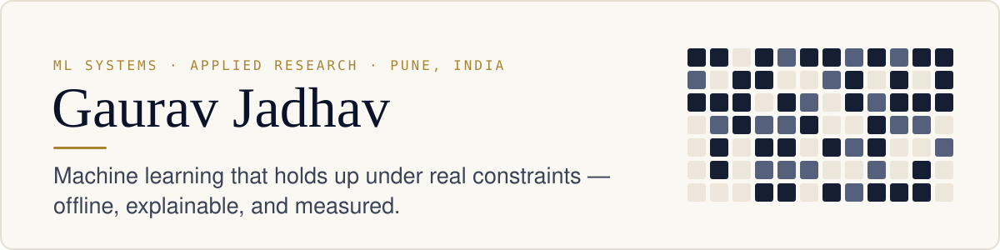

<picture>
  <source media="(prefers-color-scheme: dark)" srcset="assets/header-dark.svg">
  
</picture>

🥇 **1st Place, FinTech — MIT ADT AI Grand Challenge** · IEEE Region 10 ACEI Entrepreneurship Ambassador 2026 (India) · Top 5%, IGNISIA '26 · B.Tech IT, MMCOE Pune — CGPA 9.55

**Open to** ML & systems internships and new-grad roles, and research collaborations ahead of MS applications.

 

## Featured

### [ResQPulse AI](https://github.com/GgauravJ05/ResQPulse-AI)
Messy emergency reports, typed or spoken, become structured, prioritised, explainable alerts — offline on a laptop CPU, with a human confirming every one.

**Caught 90 of 99 real emergencies vs. 70 for the baseline · dismissed 1 high-severity report vs. 14 · gold-set macro F1 0.56 → 0.77**

`DistilBERT` `Flan-T5` `Whisper` `FastAPI` · [Code](https://github.com/GgauravJ05/ResQPulse-AI) · [Results](https://github.com/GgauravJ05/ResQPulse-AI#results)

### InsureTrust AI
Real-time insurance claim fraud screening. Image, text, tabular and claim-graph signals fuse into one SHAP-explained risk score; graph analysis surfaces organised fraud rings, 10 IRDAI red-flag rules run alongside, and every claim routes to a human adjuster.

**🥇 1st Place, FinTech — MIT ADT AI Grand Challenge**

`XGBoost` `NetworkX` `SHAP` `FastAPI` `Next.js` · [Demo](https://youtu.be/FLbIlEuwKX8) · [Code](https://github.com/MShreyash09/InsureTrust_AI) 🔒 *private — access on request*

### [NextGen Virtual File System](https://github.com/GgauravJ05/NextGen-Virtual-File-System)
A C++ file system over a flat block device — bitmap free space, inode-style records, First-Fit allocation — built to measure fragmentation, not assume it.

**At 80% occupancy over 3,000 cycles, the longest free run collapses 189 → 32 blocks and 6.7% of writes are refused on a disk that is never full.**

`C++` `TypeScript` · [Code](https://github.com/GgauravJ05/NextGen-Virtual-File-System) · [Live simulator](https://neon-vfs-console.lovable.app/)

<b>More projects</b>

 

- **LunarComm** — delay-tolerant relay mesh for an ISRO–JAXA LUPEX mission sim; rovers hold bundles through shadowed-region blackouts and burst-flush on reconnect. `Python` `NetworkX` `React Three Fiber` · [Demo](https://youtu.be/6sMI-IlAhr8)
- **PulseRoute** — XGBoost triage on EMT vitals feeds a constraint engine that hard-filters hospitals unable to treat the patient. `XGBoost` `FastAPI` `OSMnx`
- **Conflux** — peer-to-peer video meetings with live network stats, ICE restart on network change, and on-device captions. `WebRTC` `Node.js` `React` · [Code](https://github.com/GgauravJ05/conflux)
- **FlowState** — on-device cognitive-load estimation from behavioural telemetry; no data leaves the machine. Prototype. · [Demo](https://youtu.be/gaAN8GJqN3w)

Write-ups for all of these: [gauravjadhav.vercel.app/work](https://gauravjadhav.vercel.app/work)

 

## Research interests

Reliable ML under resource and safety constraints — on-device inference, honest evaluation against baselines, and human-in-the-loop decisions — and the systems behaviour underneath it, measured from first principles. Notes on the [research page](https://gauravjadhav.vercel.app/research).

**Stack** — Python · PyTorch / Transformers · XGBoost · scikit-learn · C++ · FastAPI · React · TypeScript

 

Leadership: Director of Technology, Renascent Mirai Foundation · President, IT Tech Club, MMCOE · IEEE Pune Section & MMCOE Student Branch. Writing on <a href="https://medium.com/@ggauravj5">Medium</a>. 
The fastest way to reach me is <a href="mailto:ggauravj05@gmail.com">ggauravj05@gmail.com</a> — I reply within a day.
